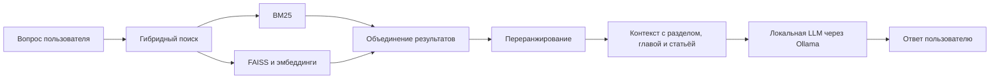

# RAG-ассистент по Конституции Российской Федерации

Локальный ИИ-ассистент, который находит релевантные положения Конституции РФ и формирует ответ на естественном языке с опорой на найденный текст. Проект демонстрирует полный RAG-процесс: подготовку документов, гибридный поиск, ранжирование фрагментов, генерацию ответа через локальную языковую модель и доступ к системе через API и веб-интерфейс.

> Проект создан в образовательных и демонстрационных целях. Ответы модели не являются юридической консультацией; важные положения следует проверять по официальному тексту Конституции РФ.

## Возможности

- Извлечение структуры документа Word: разделов, глав и статей.
- Разбиение текста на фрагменты с сохранением структурных метаданных.
- Семантический поиск по векторам FAISS и полнотекстовый поиск BM25.
- Объединение результатов поиска и переранжирование cross-encoder моделью.
- Генерация ответа локальной LLM на основе найденного контекста.
- HTTP API на FastAPI и простой чат-интерфейс на Streamlit.

## Как устроен поиск



При подготовке базы DOCX разбирается с учётом уровней заголовков. Фрагменты текста снабжаются метаданными раздела, главы и статьи, затем сохраняются в локальном FAISS-хранилище. При запросе приложение объединяет результаты BM25 и векторного поиска, выбирает наиболее релевантные фрагменты с помощью reranker и передаёт контекст языковой модели. Промпт просит модель ссылаться на структуру Конституции и сообщать, когда найденного контекста недостаточно.

## Технологии

| Компонент | Технология |
| --- | --- |
| Язык | Python 3.11 |
| Оркестрация RAG | LangChain |
| Эмбеддинги | `deepvk/USER-bge-m3` |
| Векторное хранилище | FAISS (`faiss-cpu`) |
| Лексический поиск | BM25 |
| Переранжирование | `qilowoq/bge-reranker-v2-m3-en-ru` |
| Генерация ответов | Ollama, `gpt-oss:20b` |
| API | FastAPI, Uvicorn |
| Интерфейс | Streamlit |

## Запуск

### Требования

- Conda или Miniconda.
- Ollama с доступной моделью `gpt-oss:20b`.
- Достаточно памяти и дискового пространства для локальных моделей. Модели эмбеддингов и reranker загружаются из Hugging Face при первом запуске соответствующих компонентов.

### Установка окружения

Из корня репозитория создайте окружение Conda:

```bash
conda env create --file environment.yml --prefix ./.conda/rag
conda activate ./.conda/rag
```

### Подготовка модели генерации

Запустите Ollama и загрузите модель:

```bash
ollama pull gpt-oss:20b
```

### Запуск API

Из корня проекта:

```bash
uvicorn api.api:app --host 0.0.0.0 --port 8000
```

Документация API и интерактивная форма доступны по адресу [http://localhost:8000/docs](http://localhost:8000/docs). Основной endpoint: `POST /generate`.

Пример запроса:

```bash
curl -X POST "http://localhost:8000/generate" \
  -H "Content-Type: application/json" \
  -d '{"query":"Какие права и свободы гарантирует Конституция РФ?"}'
```

Ожидаемая форма ответа:

```json
{
  "answer": "Краткий ответ: ... Подробно: ..."
}
```

### Запуск веб-интерфейса

Откройте второй терминал, активируйте то же окружение из корня репозитория и запустите:

```bash
streamlit run streamlit_app/app.py
```

Streamlit откроет локальную страницу приложения. Для стандартной локальной установки оставьте выбранным адрес API `localhost (127.0.0.1:8000)`.

## Пересоздание индекса

В репозитории уже находится индекс `db/faiss_store`, поэтому для первого запуска создавать его заново не требуется. Если исходный DOCX обновлён или индекс удалён, из корня проекта выполните:

```bash
python -m db.create_local_vector_store
```

Скрипт читает `data/constitutionrf.docx` и сохраняет новый индекс в `db/faiss_store`.

## Структура проекта

```text
api/                  FastAPI-приложение и endpoint генерации
data/                 Исходный DOCX с текстом Конституции РФ
db/                   Скрипт построения и локальный индекс FAISS
llm/                  Сборка контекста и вызов Ollama
retriever/            Гибридный поиск и переранжирование
scripts/              Извлечение структуры DOCX, разбиение и форматирование
streamlit_app/        Пользовательский веб-интерфейс
tests/                Интерактивные сценарии для компонентов проекта
environment.yml       Окружение Conda для API и RAG-компонентов
```

## Ограничения

- Качество ответа зависит от полноты индекса и релевантности найденных фрагментов.
- База документов ограничена исходным файлом Конституции РФ.
- Генерация требует работающего Ollama и ресурсов для запуска модели `gpt-oss:20b`.
- Код API создаёт компоненты поиска при старте приложения; загрузка локальных моделей может занять время.
- Приложение не заменяет проверку первоисточника и консультацию квалифицированного юриста.
